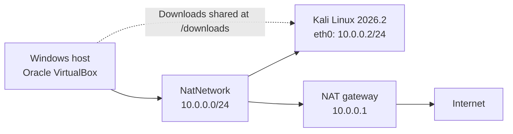
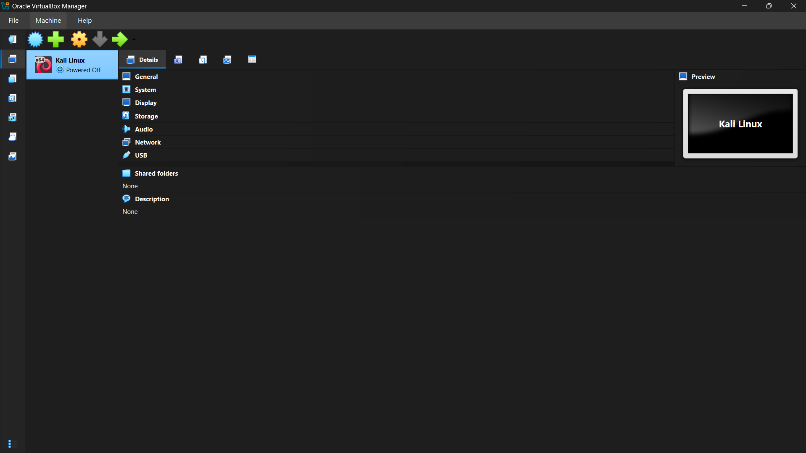
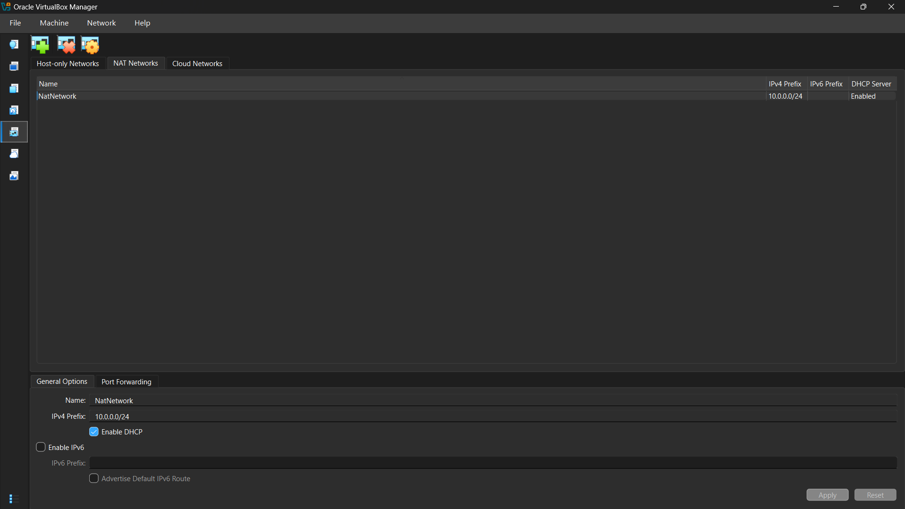
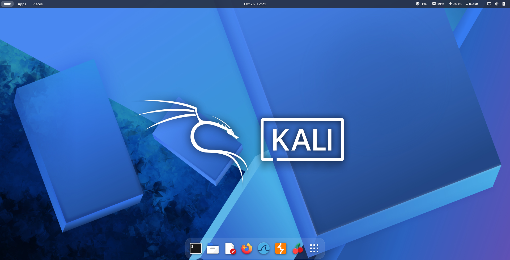
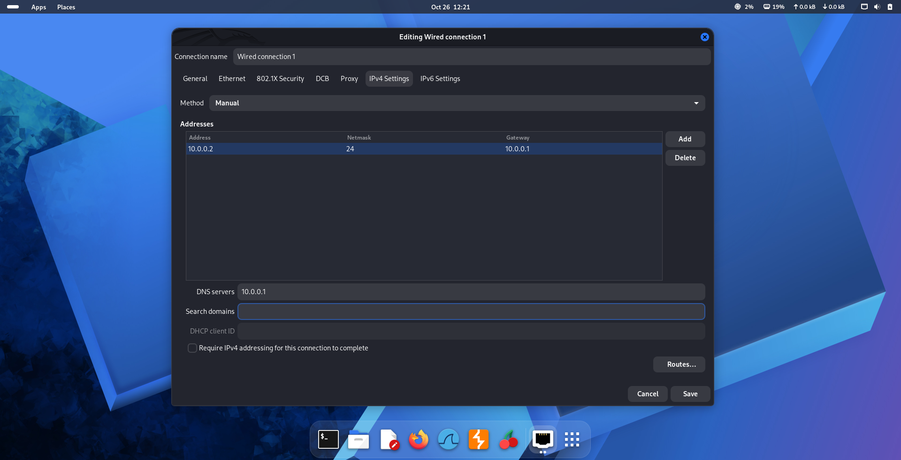

<div align="center">

# Kali Linux VirtualBox Lab

**Kali Linux deployment · NAT Network configuration · Static IPv4 · Connectivity verification**

**Uwes Kulabkar**


</div>

## Overview

This repository documents the installation and configuration of a **Kali Linux 2026.2** virtual machine in **Oracle VirtualBox**. The project covers virtual-machine provisioning, a custom NAT Network, manual IPv4 addressing, Internet and DNS testing, and file sharing between the host and guest.

The setup was carried out as a practical cybersecurity lab exercise. The screenshots and terminal results below reflect the configuration used during the exercise.

## Configuration

| Component | Configuration |
| --- | --- |
| Hypervisor | Oracle VirtualBox |
| Guest OS | Kali Linux 2026.2 (64-bit) |
| VM resources | 6 GB RAM · 4 vCPUs · 70 GB virtual disk (VDI) |
| Graphics | VMSVGA · 128 MB video memory |
| Virtual NIC | Intel PRO/1000 MT Desktop (82540EM) |
| Network mode | NAT Network (`NatNetwork`) |
| Network range | `10.0.0.0/24` · NAT DHCP enabled |
| Kali interface | `eth0` |
| Kali static IP | `10.0.0.2/24` |
| Default gateway | `10.0.0.1` |
| Active DNS observed | `10.0.0.1` |
| Host integration | Bidirectional clipboard and drag-and-drop |
| Shared directory | Windows Downloads → `/downloads` in Kali |

> **Network behavior:** The NAT Network provides outbound connectivity and can connect multiple VMs. It is not an offline or fully isolated sandbox.

## Network topology



## Implementation

### 1. Deploy Kali Linux

Created a Debian 64-bit VM in VirtualBox and installed Kali Linux using the **Kali 2026.2 AMD64 installer ISO**. Allocated 6 GB RAM, four virtual CPUs and a 70 GB virtual disk, then configured the VMSVGA display controller with 128 MB video memory.

### 2. Configure VirtualBox networking

Created a NAT Network with the following settings:

```text
Name           NatNetwork
IPv4 prefix    10.0.0.0/24
DHCP server    Enabled
IPv6           Disabled
```

Connected **Adapter 1** of the Kali VM to `NatNetwork`, using the Intel PRO/1000 MT Desktop virtual adapter, with the virtual network cable connected.

### 3. Assign the static IPv4 configuration

Inside Kali's network connection editor, configured `Wired connection 1` with **Manual** IPv4 addressing:

```text
Interface      eth0
IP address     10.0.0.2
Prefix         /24
Gateway        10.0.0.1
Active DNS     10.0.0.1
```

The NAT Network's DHCP service remained enabled, while Kali itself used a manually assigned address. Address assignment was verified using `ip -4 addr show eth0` and `ip route`.

### 4. Configure guest integration

Enabled bidirectional clipboard and drag-and-drop in VirtualBox. Configured the host's **Downloads** directory as a shared folder mounted at `/downloads` inside Kali and confirmed that the shared folder was accessible.

The guest's shared-folder group membership was configured with:

```bash
sudo usermod -aG vboxsf "$USER"
```

After restarting the guest, the shared directory could be accessed at `/downloads`.

## Verification

The following commands were run in Kali to validate the network setup:

```bash
ip -4 addr show eth0
ip route
nmcli device show eth0 | grep IP4.DNS
ping -c 3 8.8.8.8
ping -c 3 google.com
```

| Check | Observed result |
| --- | --- |
| IPv4 address | `10.0.0.2/24` on `eth0` |
| Default route | `default via 10.0.0.1 dev eth0 proto static` |
| DNS | `IP4.DNS[1]: 10.0.0.1` |
| Internet connectivity | `8.8.8.8` — 3 replies, 0% packet loss |
| Domain resolution | `google.com` — 3 replies, 0% packet loss |
| Windows–Kali file sharing | Downloads accessible through `/downloads` |

**Result:** Static addressing, default routing, outbound Internet connectivity, DNS resolution and shared-folder access were demonstrated during the lab.

## Troubleshooting: static IP activation

While configuring the required `10.0.0.2` address, NetworkManager initially rejected the connection because it detected another MAC address responding for that IP:

```text
IP address 10.0.0.2 cannot be configured because it is already in use in the network
```

The lab's troubleshooting procedure included the following NetworkManager setting:

```bash
sudo nmcli connection modify "Wired connection 1" ipv4.dad-timeout 0
```

The connection subsequently activated with `10.0.0.2/24`, and both IP connectivity and DNS resolution tests succeeded.

**Technical note:** `ipv4.dad-timeout 0` disables duplicate-address detection; it does not remove another device's claim to the address. The earlier address conflict was not independently shown to have disappeared. On a production network or a reused lab subnet, investigate and resolve the duplicate before relying on this configuration.

## Screenshots

The following are the **original, unmodified screenshots** from the lab. Select an image to open the full-resolution PNG file.

### VirtualBox virtual machine

<a href="screenshots/virtualbox-manager.png"></a>

*VirtualBox Manager showing the registered Kali Linux VM.*

### VirtualBox NAT Network

<a href="screenshots/nat-network.png"></a>

*`NatNetwork` configured with subnet `10.0.0.0/24`, DHCP enabled, and IPv6 disabled.*

### Kali Linux desktop

<a href="screenshots/kali-desktop.png"></a>

*Running Kali Linux after installation and initial setup.*

### Kali Linux IPv4 configuration

<a href="screenshots/kali-static-ipv4.png"></a>

*Manual IPv4 configuration showing `10.0.0.2/24`, gateway `10.0.0.1`, and the configured DNS settings.*

## Recovery and lab safety

Create a **clean VirtualBox snapshot** once the desired baseline configuration is finalized, before making further changes or adding intentionally vulnerable targets. Avoid exposing host files through shared folders during untrusted or higher-risk experiments.

Use this lab only for systems you own or are authorized to assess. Do not publish virtual disks, credentials, session tokens, or personal files from the shared Downloads directory.

## References

- [Kali Linux — Official Documentation](https://www.kali.org/docs/)
- [Oracle VirtualBox — User Manual](https://www.virtualbox.org/manual/)
- [NetworkManager — Documentation](https://networkmanager.dev/docs/)
- **NetworkWalks Academy** — *Week 1, Project Module 1: VirtualBox and Kali Linux Lab Setup* (internship assignment)

---

**Uwes Kulabkar** · Cybersecurity Lab Setup · October 2026
